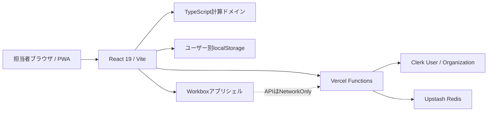

# Car Plan Advisor システム設計書

| 項目 | 内容 |
| --- | --- |
| 文書版 | 2.0 |
| 保存スキーマ | v11 |
| 更新日 | 2026-07-10 |
| 本番URL | https://files-mentioned-by-the-user-codex-eight.vercel.app/ |

## 1. 目的と境界

Car Plan Advisorは、営業担当者が現状維持・現金一括・クレジット・BVC・おまとめプランを同条件で比較し、支払と維持費を顧客へ説明する商談支援PWAである。

正式な与信、契約、税額確定、保険見積、決済、CRM、自動おすすめ判定は対象外とする。

## 2. システム構成



| 層 | 技術 | 責務 |
| --- | --- | --- |
| UI | React 19 / TypeScript | 入力、進捗、比較、印刷、競合解決 |
| 計算 | Decimal.js +純粋関数 | 支払、維持費、結果正規化 |
| 認証 | Clerk React / Backend | 招待ユーザー、店舗組織、役割 |
| API | Vercel Functions | 認証、権限、検証、ページング |
| 保存 | localStorage / Upstash Redis | 下書き、同期キュー、クラウド見積 |
| PWA | vite-plugin-pwa / Workbox | 静的アプリシェル、更新通知 |
| 品質 | Vitest / Testing Library / ESLint | 計算・UI・移行・同期回帰 |

画面単位で`DetailInputScreen`と`CustomerPresentation`を遅延読込し、認証画面の初期JavaScript量を抑える。

## 3. 画面設計

### 3.1 認証

- `VITE_CLERK_PUBLISHABLE_KEY`がある環境ではClerk SignInを使用する。
- 公開登録は無効化し、管理者招待だけを許可する。
- アクティブなClerk Organizationがないユーザーはアプリへ進めない。
- Clerk未設定環境では、移行確認用として旧HttpOnly Cookie認証へフォールバックする。

### 3.2 詳細入力

PCはフォームと追従結果の2カラム、900px以下は1カラムとする。右側は入力進捗、セクションリンク、次の未入力、比較結果を表示する。

入力構成:

1. 商談情報
2. 車両情報・購入／下取金額
3. 比較対象プラン
4. 現在の車
5. 新車の維持費条件
6. 中古車の維持費条件
7. 有効な購入プランの条件

比較対象をオフにしても入力値は保持する。新車選択時の中古車維持費は補助設定として折りたたむ。必須入力は`required`、`aria-required`、`aria-invalid`、エラー説明を付与する。

### 3.3 お客様説明

- 実際に選択されたプラン件数を表示する。
- 未完成プランは表・カードで数値を`要入力`とし、部分金額を表示しない。
- 実質総額チャートと維持費内訳は完成済みプランだけを表示する。
- PCは比較表、スマホはカードへ切り替え、横スクロールを発生させない。

### 3.4 モバイル

ヘッダーは2段以内とし、保存とモード切替を常時表示する。共有、印刷、再同期、ログアウトは「その他」へ格納する。進捗は狭幅でも1カラムで表示する。

### 3.5 未保存変更

見積切替、新規見積、ログアウト、ブラウザ離脱で未保存変更を検知する。保存済みスナップショットと現在のScenario JSONを比較し、破棄前に確認する。

## 4. データ設計

### 4.1 Scenario v11

```text
Scenario
├── schemaVersion: 11
├── comparison.enabledPlans: cash / credit / bvc / omatome
├── quote
├── vehicle
├── currentCar
├── newMaintenance
├── usedMaintenance
├── cash
├── credit
├── bvc
└── omatome
```

金額入力は`number | ''`で空欄と0円を区別する。維持期間は1〜20年の整数とする。

### 4.2 検証結果

`ScenarioValidationIssue`は`sectionId / fieldId / planId / message / severity`を持つ。`ComparisonResult`は`visiblePlanCount / completePlans / incompletePlans / validationIssues`を持ち、画面・印刷可否の唯一の判定元とする。

### 4.3 クラウドレコード

`CloudScenarioRecord`は見積本体に加え、次を保持する。

- `organizationId`
- `ownerUserId / ownerName`
- `createdBy / updatedBy`
- `serverUpdatedAt`
- `revision`

一覧ではScenario本体を除いた`CloudScenarioSummary`だけを返す。

## 5. 計算設計

### 5.1 車両価格と維持費の対応

| プラン | 新車選択 | 中古車選択 |
| --- | --- | --- |
| 現状維持 | 現在車条件 | 現在車条件 |
| 現金一括 | 新車価格・新車維持費 | 中古車価格・中古車維持費 |
| クレジット | 新車価格・新車維持費 | 中古車価格・中古車維持費 |
| BVC | 新車価格・新車維持費 | 新車価格・新車維持費 |
| おまとめ | 新車価格・新車維持費 | 新車価格・新車維持費 |

### 5.2 車検

- 新車: 初度登録36か月目、以後24か月ごと。
- 現在車: `現在年月 - 初度登録年月`で開始車齢を求める。
- 現在月と車検月が一致すれば計上する。
- 維持終了月と車検月が一致すれば計上しない。
- 法定12か月点検と6か月点検は車検月との重複を除く。
- BVC返却時の車検は最大1回、買取時は通常周期とする。

### 5.3 現状維持

実質総額は従来の累計比較を維持する。実質月額だけを将来負担として計算する。

```text
維持費月額 = これからの維持費 ÷ 維持月数
月額入力あり = 月額 + 維持費月額
月額なし・残債あり = 残債 ÷ 維持月数 + 維持費月額
どちらもなし = 維持費月額
```

### 5.4 購入プラン

- 現金: 下取控除後価格を一括支払とし、維持月数で月々換算する。
- クレジット: 初回・月額が空欄なら金利自動計算、いずれか入力時は手入力方式とする。
- BVC: 36／48／60回。返却は3／4／5年連動、買取だけ維持年数を入力する。残価は通常回数に含めない。
- おまとめ: 36／60／84回。最終回支払は通常回数に含めず、買取時だけ加える。固定維持費は支払期間内込み、期間超過と未選択保険と修理費は顧客負担とする。

## 6. 保存・同期

### 6.1 ローカル

v11見積、同期キューv2、移行済みv2は`organizationId:userId`を含むキーへ保存する。Clerk利用者間で端末内見積を共有しない。旧認証中は従来の非スコープキーを使う。

下書き保存は未完成でも許可する。

### 6.2 クラウド権限

- `org:member`: `ownerUserId === actor.userId`だけ読取・更新・削除可能。
- `org:admin`: 組織内全件の読取・更新・削除・担当者割当が可能。
- Organization、利用者、役割はClerkトークンから決定する。
- 担当者割当はClerk Organization membershipをサーバーで照合する。
- 組織外IDやクライアント指定の所有者情報は採用しない。

### 6.3 同期と競合

- 一覧は検索・所有者フィルター・カーソルで50件ずつ返す。
- 本文は`GET /api/scenarios?id=...`で選択時に取得する。
- 同期キューは同一IDの最新操作だけを残し、先頭から順に送る。
- 更新時の`revision`不一致は409とする。
- UIでサーバー版採用または端末版強制上書きを選択する。
- 削除日時と`queuedAt`を比較し、削除前に登録された更新で復活させない。

### 6.4 旧見積

管理者が明示操作したときだけ旧Redisハッシュから移行する。IDと更新日時を維持し、`ownerUserId = null`、`ownerName = 未割当`とする。元データは自動削除しないため、移行処理は再実行可能である。

## 7. API

| Method | Path | 概要 |
| --- | --- | --- |
| GET | `/api/scenarios?limit=50&cursor=&q=&owner=` | 権限内の概要一覧 |
| GET | `/api/scenarios?id=...` | 見積本文取得 |
| PUT | `/api/scenarios` | 作成・更新 |
| PUT | `/api/scenarios?force=true` | 明示的な競合上書き |
| DELETE | `/api/scenarios?id=...` | 削除・墓標作成 |
| PATCH | `/api/scenarios?id=...` | 管理者の担当者割当 |
| POST | `/api/scenarios?action=migrate-legacy` | 管理者の旧見積移行 |
| GET | `/api/members` | 管理者用店舗メンバー一覧 |

更新系はSame Origin、本文サイズ、ID、名称、v11スキーマを検証する。API応答は`no-store, private`とする。

旧`/api/auth/login|session|logout`はClerk切替確認まで残す。

## 8. セキュリティ

- Clerk秘密鍵、Redisトークン、旧署名秘密鍵はサーバー環境変数だけに置く。
- Clerk Marketplaceの`NEXT_PUBLIC_CLERK_PUBLISHABLE_KEY`はサーバー認証で参照し、Vite用には同じ公開値を`VITE_CLERK_PUBLISHABLE_KEY`へ複製する。
- CSP、`X-Content-Type-Options`、`Referrer-Policy`、`Permissions-Policy`、`frame-ancestors`をVercelレスポンスへ付与する。
- Service Workerは`/api/**`をNetworkOnlyとし、認証・見積をキャッシュしない。
- 共有URLから顧客名・担当者名を除外する。
- `check:secrets`でソースとdistを検査する。

## 9. 印刷

- A4横2ページ、ライト背景、淡い赤・グレーのアクセント。
- 1ページ目: 概要と完成済みプランの支払比較。
- 2ページ目: プラン別維持費金額、回数・周期。
- 未完成の有効プランがあればアプリの印刷操作を停止し、入力またはプラン解除を促す。
- おまとめ固定込み項目は顧客負担0円、期間超過・未選択保険・修理費は実額とする。

## 10. 品質と運用

標準ゲート:

```bash
npm run typecheck
npm run lint
npm test
npm run build
npm run check:forbidden
npm run check:secrets
```

Clerk Marketplace導入、Preview公開、本番切替、旧認証API・環境変数削除は別々の運用ゲートとする。本番切替前に管理者で旧見積移行件数、担当者権限、組織外拒否、未認証401、PWA更新、A4横2ページを確認する。
